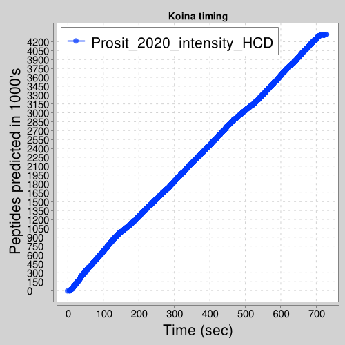
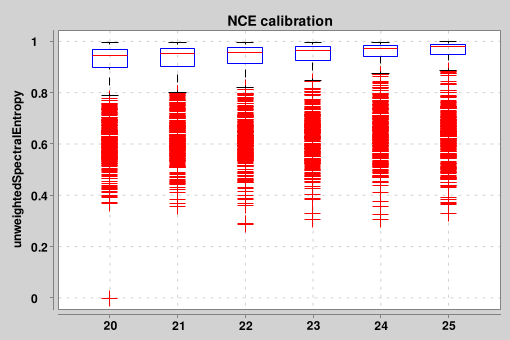

# Using Koina with MSBooster
Last updated: 11/17/2026

## Why use Koina?
[Koina](https://koina.proteomicsdb.org/) (described in 
[Lautenbacher, Yang et al., Nature Communications, 2025](https://www.nature.com/articles/s41467-025-64870-5))
is an online service that allows us to leverage a GPU server to get predictions from multiple MS2 spectra, 
retention time (RT), and ion mobility (IM) models, thereby democratizing deep learning. The models on Koina may be 
more specific to your use case than the local models (FragCast, or DIA-NN, which command-line MSBooster runs when no
model is named). As a result, predictions may be more accurate, resulting in increased peptide identifications. The
following models are currently supported by MSBooster:

| Model | Kind | Also sent with each peptide | Mods sent | Peptides taken |
|---|---|---|---|---|
| AlphaPept_rt_generic | RT | - | AlphaPeptDeep mods | any |
| Prosit_2019_irt | RT | - | Prosit mods | up to 30 residues, charge up to 6 |
| Prosit_2020_irt_TMT | RT | - | Prosit TMT mods | up to 30 residues, charge up to 6 |
| Prosit_2024_irt_cit | RT | - | Prosit citrullination mods | up to 30 residues, charge up to 6 |
| Prosit_2025_irt_22PTM | RT | - | Prosit-PTM mods | up to 30 residues, charge 1-6 |
| Prosit_2025_irt_lac | RT | - | lactylation mods | up to 30 residues, charge 1-6, no free cysteine |
| Chronologer_RT | RT | - | Chronologer mods | up to 50 residues |
| Deeplc_hela_hf | RT | - | DeepLC mods | up to 60 residues, and 60 characters as written for the model |
| ms2pip_2021_HCD | MS2 | charge | oxidation (M), carbamidomethyl (C) | up to 30 residues |
| ms2pip_timsTOF2024 | MS2 | charge | oxidation (M), carbamidomethyl (C) | up to 30 residues |
| ms2pip_timsTOF2023 | MS2 | charge | oxidation (M), carbamidomethyl (C) | up to 30 residues |
| ms2pip_CID_TMT | MS2 | charge | oxidation (M), carbamidomethyl (C); TMT is not sent | up to 30 residues |
| ms2pip_TTOF5600 | MS2 | charge | oxidation (M), carbamidomethyl (C) | up to 30 residues |
| ms2pip_Immuno_HCD | MS2 | charge | oxidation (M), carbamidomethyl (C) | up to 30 residues |
| ms2pip_iTRAQphospho | MS2 | charge | oxidation (M), carbamidomethyl (C); iTRAQ and phospho are not sent | up to 30 residues |
| AlphaPept_ms2_generic | MS2 | charge, NCE (calibrated), instrument | AlphaPeptDeep mods | any |
| Prosit_2019_intensity | MS2 | charge, NCE (calibrated) | Prosit mods | up to 30 residues, charge up to 6 |
| Prosit_2020_intensity_CID | MS2 | charge | Prosit mods | up to 30 residues, charge up to 6 |
| Prosit_2020_intensity_TMT | MS2 | charge, NCE (calibrated), fragmentation (HCD or CID) | Prosit TMT mods | up to 30 residues, charge up to 6 |
| Prosit_2020_intensity_HCD | MS2 | charge, NCE (calibrated) | Prosit mods | up to 30 residues, charge up to 6 |
| Prosit_2023_intensity_timsTOF | MS2 | charge, collision energy (calibrated over 20-70 eV) | Prosit mods | up to 30 residues, charge up to 6 |
| Prosit_2024_intensity_cit | MS2 | charge, NCE (calibrated), fragmentation (HCD or CID) | Prosit citrullination mods | up to 30 residues, charge up to 6 |
| Prosit_2025_intensity_MultiFrag | MS2 | charge, fragmentation (HCD, ECD, EID, UVPD or ETCID) | Prosit mods | up to 30 residues, charge up to 6 |
| Prosit_2025_intensity_22PTM | MS2 | charge, NCE (calibrated), fragmentation (HCD or CID) | Prosit-PTM mods | up to 30 residues, charge 1-6 |
| Prosit_2025_intensity_40PTM | MS2 | charge, NCE (calibrated), fragmentation (HCD or CID) | Prosit-PTM mods | up to 30 residues, charge 1-6 |
| Prosit_2025_intensity_lac | MS2 | charge, NCE (calibrated), instrument (ASTRAL or LUMOS), fragmentation (HCD or CID) | lactylation mods | up to 30 residues, charge 1-6, no free cysteine |
| Altimeter_2024_intensities | MS2 | charge, NCE (calibrated) | Prosit mods; terminal mods are not sent | 6-40 residues, charge 1-7, no free cysteine |
| UniSpec | MS2 | charge, NCE (calibrated), instrument | UniSpec mods | up to 40 residues, charge up to 5 |
| AlphaPept_ccs_generic | IM | charge | AlphaPeptDeep mods | any |
| IM2Deep | IM | charge | IM2Deep mods; no TMT or iTRAQ search (see [below](#before-any-prediction)) | up to 60 residues |

You can mix and match models, or even use `DIA-NN` for one of them and a Koina model for the other.

Every model but the AlphaPeptDeep ones (AlphaPept_*) leaves out peptides with O, U, B, Z, J or X. A PSM a model
cannot take is not sent to it: it gets an empty predicted spectrum, or a predicted RT or IM of 0. A mod a model
cannot be sent is left out of the peptide sent, and the model predicts the peptide as if that residue were
unmodified; for an MS2 model, the fragments that hold the mod are shifted by its mass afterwards. MSBooster says how
many PSMs each of these concerns (see [Log of what each model is sent](#log-of-what-each-model-is-sent)).

The mods each model is sent, as matched by mass to the mods in the pin files:
- **AlphaPeptDeep mods**: any mod in the AlphaPeptDeep mod tables MSBooster ships (`alphapept_koina.csv` and
`modification_alphapeptdeep.tsv`) or in the `additionalModsFile`, at the sites they list, N- and C-terminal mods
included
- **Prosit mods**: oxidation (M) and carbamidomethyl (C). Every C is sent as carbamidomethylated, so a free or
pyro-carbamidomethyl cysteine is predicted as a carbamidomethylated one
- **Prosit TMT mods**: TMT (UNIMOD:737) on K and the N-terminus, and the Prosit mods. The mass sent as TMT is the
isobaric label of the search in fragger.params (TMT 6/10/11 if it has none), so TMTpro and iTRAQ are sent as TMT. A
peptide is sent with an N-terminal TMT if it has none, and TMT on S is not sent
- **Prosit citrullination mods**: citrullination (R) and deamidation (N, Q), both UNIMOD:7, and the Prosit mods
- **Prosit-PTM mods**: the mods Koina's preprocessing for these models can encode. That is a pair of site and UniMod
code in its hand-written table, or a mod its zero-shot encoding takes: on C, D, H, I, K, L, M, Q, R, S, T, W, Y or
the peptide N-terminus, with a UniMod code in the unimod.obo Koina ships, whose delta composition holds only H, C, N,
O, P and S atoms (isotopes count as their element) and the monosaccharides Koina reads (Hex, HexNAc, Pent, HexA,
NeuAc, NeuGc, Kdn; dHex is listed but its token is not read), and
which leaves no element of the site's attachment group below zero. Koina encodes S[UNIMOD:737], for example, but
not S[UNIMOD:23]. C-terminal mods are never sent, as Koina would read them as N-terminal ones. A C without a mod is
sent as a free cysteine, and a carbamidomethylated one as C[UNIMOD:4]
- **Lactylation mods**: lactylation (UNIMOD:2114, +72.0211) on K and the N-terminus, oxidation (M) and
carbamidomethyl (C). Koina reads every C of these models as carbamidomethylated, so a peptide with a free cysteine is
not sent. C-terminal mods are never sent. These models have a mod table of their own, as the AlphaPeptDeep mod tables
give K at this mass the isobaric carboxyethyl (UNIMOD:378)
- **Chronologer mods**: carbamidomethyl and pyro-carbamidomethyl (C), oxidation (M), phospho (S, T, Y), acetyl (K and
the N-terminus), GlyGly (K), methyl and dimethyl (K, R), trimethyl (K), TMT0 (UNIMOD:739) and TMT (UNIMOD:737, the
search's isobaric label) on K and the N-terminus, and pyro-Glu (Q, E). These are the pairs of Koina's Chronologer
table but succinyl (K). A pyro-carbamidomethyl cysteine is sent as C[UNIMOD:385], the token Chronologer reads it as.
C-terminal mods are never sent, and a C without a mod is sent as a free cysteine
- **DeepLC mods**: any of the AlphaPeptDeep mods whose composition in the unimod.obo Koina ships holds only C, H, N,
O, S and P atoms (isotopes count as their element). An N-terminal mod is sent on the first residue and a C-terminal
mod on the last; when that residue has a mod of its own, it keeps its own and the terminal mod is not sent
- **IM2Deep mods**: the DeepLC mods without isotope atoms (13C, 15N, 2H, 18O)
- **UniSpec mods**: acetyl (N-terminus), carbamidomethyl and pyro-carbamidomethyl (C), oxidation (M), phospho
(S, T, Y), and pyro-Glu (Q, E)

The IM models answer with a collision cross section (CCS), which MSBooster converts to 1/K0 with the Mason-Schampp
equation for nitrogen, as AlphaPeptDeep's alphabase does. Altimeter_2024_intensities and UniSpec answer with the m/z
of each fragment, which MSBooster uses instead of calculating them. Altimeter_2024_intensities predicts b and y ions
(with or without a neutral loss), the precursor and immonium ions.

Each request carries up to 1000 precursors, except AlphaPept_ms2_generic (500) and Altimeter_2024_intensities,
Prosit_2025_intensity_MultiFrag and UniSpec (100), or fewer when the Koina server takes smaller batches (see
[the start-up check](#before-any-prediction)).

## Using Koina
Koina can be used in the FragPipe GUI or the command line interface. Below we will describe usage in both places. 
Command line MSBooster has more flexible Koina functionality.

### FragPipe GUI
MSBooster is in the "Rescoring using deep learning prediction" box of the "Validation" tab.
- The **Model** dropdown chooses what predicts RT, MS/MS spectra and IM: `FragCast`, which ships with FragPipe;
`Custom`, a model you fine-tuned in the "Transfer Learning" tab, given as one zip file; or `Koina`. FragCast and
Custom run on your computer. Only `Koina` sends the peptide sequences to a server, and the Koina box below is
greyed out unless it is chosen
- **Fragmentation type** applies to every model: it decides which fragment ions are matched, and Koina models
predict spectra for it. `auto` reads it from the first spectrum's filter string, and is HCD when there is none
- **Koina server URL** tells MSBooster where to send its HTTP requests for prediction. It starts empty, and FragPipe
does not start a run with Koina until it is filled with a URL starting with `http://` or `https://`. The public
server is `https://koina.wilhelmlab.org:443/v2/models/`
- **RT model**, **MS2 model** and **IM model (timsTOF only)** choose one Koina model each. They start on Prosit 2019
iRT, Prosit 2020 Intensity HCD and IM2Deep. The lists show a display name for each model in the table above (for
example "Prosit 2025 Intensity 22PTM" for `Prosit_2025_intensity_22PTM`); a workflow file stores the MSBooster name.
The tooltip of each model, in the open list and on the dropdown once chosen, lists the mods it is sent and the
peptides it takes, as in the table above. The IM model is used only for timsTOF data (`.d` files, or the mzML
diaTracer writes from them); for other data FragPipe names no IM model and turns off the IM features
- FragPipe always predicts with the models chosen. The GUI has no "Find best model" checkboxes: the
<a href="#notes">heuristic best model search</a> is run from the command line only

### Command line
You can use the following command to run MSBooster, adjusting the -Xmx to how much RAM you have available.
```
java -Xmx14G -jar MSBooster-1.8.0.jar --paramsList msbooster_params.txt
```
An example parameter file for "--paramsList" can be found at [msbooster_params.txt](msbooster_params.txt). 
Important parameters when using Koina are explained below:
<details>
<summary>Koina required parameters</summary>
<ul>
    <li><code>KoinaURL (String)</code>: It is by default kept blank, as an acknowledgement that using it may potentially send the 
    peptides you are predicting to an external public server. If you are OK with this, you may use
    <code>https://koina.wilhelmlab.org:443/v2/models/</code> or a different URL (e.g. for a 
    <a href="#notes">private Koina instance</a>). The URL ends with <code>/v2/models/</code>, as the model name is
    appended to it</li>
    <li><code>rtModel (String)</code>: If kept blank, it will default to <code>DIA-NN</code>. You may specify this or any of the 
    RT models listed above. This will be ignored if <code>useRT</code> is set to false</li>
    <li><code>spectraModel (String)</code>: If kept blank, it will default to <code>DIA-NN</code>. You may specify this or any of 
    the MS2 models listed above. This will be ignored if <code>useSpectra</code> is set to false</li>
    <li><code>imModel (String)</code>: If kept blank, it will default to <code>DIA-NN</code>. You may specify this or any of 
    the IM models listed above. This will be ignored if <code>useIM</code> is set to false</li>
</ul>
Model names are case-insensitive. A name MSBooster does not know ends the run with exit status 1, listing the Koina
models of that kind.
</details>

<details>
<summary>Koina optional parameters</summary>
<ul>
    <li><code>findBestRtModel (boolean)</code>: Set to <code>true</code> if you would like to use the 
    <a href="#notes">heuristic best RT model</a> search to find which of the models offered works 
    best for your data. Otherwise, set as <code>false</code></li>
    <li><code>findBestSpectraModel (boolean)</code>: Set to <code>true</code> if you would like to use the heuristic best spectral 
    model search to find which of the models offered works best for your data. Otherwise, set as <code>false</code></li>
    <li><code>findBestImModel (boolean)</code>: Set to <code>true</code> if you would like to use the heuristic best IM model 
    search to find which of the models offered works best for your data. Otherwise, set as <code>false</code></li>
    <li><code>ms2SearchModelsString (String)</code>: Controls which models are searched during the heuristic best spectral model 
    search. It should be formatted with models separated by commas, and no spaces in between. If you would like to take
    out specific models, you can remove them from here. For example, if you are working with timsTOF data, you may want 
    to reduce the search to only those models that explicitly have timsTOF models (<code>AlphaPept_ms2_generic,
    Prosit_2023_intensity_timsTOF</code>). Models are case-insensitive (e.g. prosit_2020_Intensity_cid), but they must 
    be spelled correctly. If kept blank, the models of <code>ms2Collection</code> are searched</li>
    <li><code>ms2Collection (String)</code>: the models searched when <code>ms2SearchModelsString</code> is blank.
    <code>general</code> (default): <code>DIA-NN,FragCast,ms2pip_2021_HCD,ms2pip_TTOF5600,AlphaPept_ms2_generic,
    Prosit_2020_intensity_CID,Prosit_2020_intensity_HCD</code>; <code>isolabel</code>: 
    <code>Prosit_2020_intensity_TMT,ms2pip_CID_TMT,ms2pip_iTRAQphospho</code>; <code>hla</code>: 
    <code>DIA-NN,FragCast,ms2pip_Immuno_HCD,AlphaPept_ms2_generic,Prosit_2020_intensity_CID,
    Prosit_2020_intensity_HCD</code>; <code>timstof</code>: <code>DIA-NN,FragCast,ms2pip_timsTOF2024,
    AlphaPept_ms2_generic,Prosit_2023_intensity_timsTOF</code>. MSBooster sets it to <code>isolabel</code> when
    fragger.params has a TMT or iTRAQ mod</li>
    <li><code>rtSearchModelsString (String)</code>: Same as <code>ms2SearchModelsString</code>, but for RT models, and
    <code>rtCollection</code> is searched when it is blank: <code>general</code> (default): 
    <code>DIA-NN,FragCast,AlphaPept_rt_generic,Prosit_2019_irt,Deeplc_hela_hf</code>; <code>isolabel</code>, which
    MSBooster sets when fragger.params has a TMT or iTRAQ mod: 
    <code>DIA-NN,FragCast,Prosit_2020_irt_TMT,AlphaPept_rt_generic,Deeplc_hela_hf</code></li>
    <li><code>imSearchModelsString (String)</code>: Same as <code>ms2SearchModelsString</code>, but for IM models. If kept
    blank, <code>DIA-NN,FragCast,AlphaPept_ccs_generic,IM2Deep</code> are searched</li>
    <li>None of the collections holds Prosit_2025_irt_22PTM, Prosit_2025_irt_lac, Chronologer_RT,
    Prosit_2025_intensity_22PTM, Prosit_2025_intensity_40PTM, Prosit_2025_intensity_lac, Altimeter_2024_intensities
    or ms2pip_timsTOF2023. To search them, name them in the search string. A model that cannot be sent the search's
    TMT or iTRAQ label (IM2Deep) is left out of the search, with a log line saying so</li>
    <li><code>calibrateNCE (boolean)</code>: Set to <code>true</code> if you would like to find the optimal collision energy for 
    MS2 predictions across the mzML files. Otherwise, set to <code>false</code> (default is true). The collision
    energy is sent to, and calibrated for, AlphaPept_ms2_generic, Altimeter_2024_intensities, UniSpec, and every
    Prosit intensity model but Prosit_2020_intensity_CID and Prosit_2025_intensity_MultiFrag. Each NCE of the
    model's range is tried, and the one with the highest median similarity is chosen. If false, MSBooster will attempt
    to read in the NCE from the mzML file. If it cannot find the NCE, it will be set to <code>NCE</code></li>
    <li><code>NCE (int)</code> (int): if calibrateNCE is <code>false</code>, the NCE used for prediction when it is not
    read from the mzML file, as when <code>FragmentationType</code> is set to a type rather than <code>auto</code>, or
    the mzML has no filter string (default is 25)</li>
    <li><code>instrument (String)</code>: instrument used for prediction. Only used by AlphaPept_ms2_generic, UniSpec and
    Prosit_2025_intensity_lac. While MSBooster attempts to automatically read this from the mzml metadata (LUMOS, QE,
    SCIEXTOF, TIMSTOF, or THERMOTOF for an Astral; QE if it cannot tell), it can be explicitly provided here. Each
    model is sent the instrument in its own terms: AlphaPept_ms2_generic takes QE, LUMOS, TIMSTOF and SCIEXTOF, and is
    sent QE for any other; UniSpec takes LUMOS, QE, QEHFX, ELITE and VELOS, and is sent NONE for any other and for a
    charge 1 precursor on QE or QEHFX; Prosit_2025_intensity_lac is sent ASTRAL for THERMOTOF and LUMOS for any other</li>
    <li><code>minNCE (int)</code> and <code>maxNCE (int)</code>: the lowest and highest NCE to search when calibrating
    NCE. They are not set by default, and each model is then calibrated over its own range: 20-40, or 20-70 for
    Prosit_2023_intensity_timsTOF, whose collision energy is in eV. Set, either one replaces that end of the range for
    every model calibrated. A range they leave empty (minNCE above maxNCE, minNCE above a model's highest NCE, or
    maxNCE below its lowest) ends the run before any model is calibrated</li>
    <li><code>numPSMsToCalibrate (int)</code>: number of PSMS to use for NCE calibration and best model search (default is 
    1000)</li>
    <li><code>autoSwitchFragmentation (boolean)</code>: kept so that older parameter files still load; it no longer
    changes anything. When the run's fragmentation type is not one a model takes (see the table above), MSBooster
    switches it to HCD for that model, and says so in the log</li>
</ul>
</details>

## What MSBooster checks
MSBooster checks the Koina models of a run before it predicts with them, and ends the run with exit status 1 and a
message naming the model and the reason when one of them cannot be used. FragPipe then stops too.

### Before any prediction
- **The model names.** A model name MSBooster does not know ends the run. `PredFull` is no longer a model.
- **The search's isobaric label.** IM2Deep cannot be sent peptides with TMT or iTRAQ. If fragger.params has a TMT or
iTRAQ mod and the run predicts IM with IM2Deep, the run ends with a message suggesting AlphaPept_ccs_generic instead.
- **The NCE range**, as above.
- **The start-up model check.** Before the pin files are read for a Koina model, MSBooster asks the Koina server
about it: `GET <KoinaURL><model>` for the model's metadata, and `GET <KoinaURL><model>/config` for its
configuration. Each model is asked about once per run.
  - A model the server does not serve (HTTP 400 or 404, or an answer that is not model metadata) ends the run,
  before any request is sent to it. The message asks you to check the model name, and that the Koina URL ends with
  `/v2/models/`. A candidate of the best model search ends the run the same way.
  - A model that does not answer with every output MSBooster reads ends the run.
  - If the server takes smaller batches than MSBooster would send (`max_batch_size`), each request carries that
  many precursors, and the log says so.
  - A server that does not answer is asked again, as a request is (`numKoinaAttempts`). If it still does not
  answer, the requests are sent anyway, with the batch sizes above, and the log says so.

### Log of what each model is sent
After reading the pin files for a Koina model, MSBooster writes one block saying what the model is sent:

```
<model> is sent <n> of <N> PSMs, as <P> precursors
  <k> PSMs not sent, as the model cannot take them: <reason> (<count>), ...
  mods the model cannot encode, left out of the peptides sent (PSMs): <mod> (<count>), ...; <what happens>
```

The second line is there only when some PSMs are not sent; the reasons are `residue X`, `shorter than ... residues`,
`longer than ... residues`, `charge below ...`, `charge above ...`, `free cysteine`, and `longer than ... characters
as written for the model`. The third line is there only when some mods are left out. Each mod is written as in the
pin file, after its residue, or after `n` or `c` for an N- or C-terminal mod (e.g. `S[79.9663]`, `n[42.0106]`), with
the number of PSMs that have it. For an MS2 model, it ends with "the fragments that hold one are shifted by its
mass"; for an RT or IM model, with "predicted as if unmodified there".

If a model can take none of the PSMs, the run ends there, before any request is written, with the reasons:

```
Koina model <model> cannot take any of the <N> PSMs: <reason> (<count>), ..., so it has nothing to predict. Choose another model
```

### Precursors Koina refuses
Koina answers HTTP 400 to a request holding a precursor its model cannot take. MSBooster does not send such a request
again as it is. It cuts the request in halves and sends each half, and cuts a refused half again, until each
precursor Koina refuses is alone in a request. A request of one precursor that Koina refuses is sent once more, 5
seconds later, since Koina also answers HTTP 400 when it fails for a reason of its own; the precursor counts as refused
only when Koina refuses it again. An HTTP 400 whose answer says the model instance failed (a CUDA error such as
"device-side assert triggered", or memory running out) is not a refusal: such an instance fails every request until
Koina restarts it, so MSBooster sends the request again whole, as for a response it did not receive (up to 5 times,
then the run ends). The other precursors are predicted. The refused ones get no prediction, and are
scored as PSMs the model cannot take. The log of the prediction lists them, up to 20, with what Koina answered (an RT
model is sent no charge, so its lines name none):

```
Koina model <model> refused <n> precursors (HTTP 400). The other precursors of their requests are predicted; these have no prediction and are scored as precursors the model cannot take:
  <peptide> charge <z>: <what Koina answered>
  ...
  and <m> more
```

The run ends if Koina refuses every precursor it is sent. It also ends if Koina refuses every request whatever it
holds, as it does for an input the model does not take. MSBooster finds that out without cutting every request: when
the first request is refused before anything was predicted, up to 8 of its precursors are sent alone first, and the
other refused requests wait. The message then asks you to check that the model takes the run's instrument,
fragmentation and collision energy.

## Output files
In addition to [edited pin files, score histograms, and RT/IM calibration curves](README.md#graphical-output-files), several other files are produced when running Koina:
- `*.koina.mgf`: Contains the MS2/RT/IM predictions from the Koina models, named after them (e.g.
`spectra-ms2pip_2021_HCD.koina.mgf`). RT/IM will be 0.0 if a local model (FragCast or DIA-NN) predicted them or
no RT/IM prediction was performed. FragViz reads this file from the `MSBooster` folder of a FragPipe result for mirror
plots of experimental vs predicted spectra, if MSBooster was most recently run with a Koina MS/MS model
- `Koina_timing_*.png`: A useful figure to keep track of how long it took to run the Koina model

- 
- `NCE_calibration*.png`: MS/MS similarities of the PSMs used to find the optimal NCE across files. The NCE with
highest median similarity is chosen. A few figures like this are produced, since there is a wide range of NCEs tested
that make it hard to visualize all in a single figure

  

## Log file examples

<details>
<summary> Set both models to AlphaPept </summary>

```
2024-07-24 13:25:13 [INFO] - MSBooster v1.2.38
2024-07-24 13:25:13 [INFO] - Using 55 threads
2024-07-24 13:25:13 [INFO] - Initializing example.mzML
2024-07-24 13:25:15 [INFO] - Instrument detected: QE
2024-07-24 13:25:15 [INFO] - Ion mobility values not found in data files, setting useIM to false.
2024-07-24 13:25:15 [INFO] - Fragmentation type detected: HCD
2024-07-24 13:25:15 [INFO] - NCE detected: 27.0
2024-07-24 13:25:16 [INFO] - Creating input file for createFull
2024-07-24 13:25:16 [INFO] - 32135 PSMs for prediction
2024-07-24 13:25:16 [INFO] - createFull input file generation took 163 milliseconds
2024-07-24 13:25:16 [INFO] - Input file at spectraRT_full.tsv
2024-07-24 13:25:16 [INFO] - Calibrating NCE
2024-07-24 13:25:26 [INFO] - Best NCE for AlphaPept_ms2_generic after calibration is 28
2024-07-24 13:25:26 [INFO] - Median similarity for AlphaPept_ms2_generic is 0.9864
2024-07-24 13:25:26 [INFO] - Creating input file for AlphaPept_ms2_generic
2024-07-24 13:25:27 [INFO] - 31944 PSMs for prediction
2024-07-24 13:25:27 [INFO] - AlphaPept_ms2_generic input file generation took 385 milliseconds
2024-07-24 13:25:27 [INFO] - Input files in jsonFiles
2024-07-24 13:25:27 [INFO] - Creating input file for AlphaPept_rt_generic
2024-07-24 13:25:27 [INFO] - 31944 PSMs for prediction
2024-07-24 13:25:27 [INFO] - AlphaPept_rt_generic input file generation took 157 milliseconds
2024-07-24 13:25:27 [INFO] - Input files in jsonFiles
2024-07-24 13:25:27 [INFO] - Calling AlphaPept_ms2_generic model
...10%...20%...30%...40%...50%...60%...70%...80%...90%...100%
2024-07-24 13:25:36 [INFO] - cURL and parse time in milliseconds: 8731
2024-07-24 13:25:36 [INFO] - Calling AlphaPept_rt_generic model
...10%...20%...30%...40%...50%...60%...70%...80%...90%...100%
2024-07-24 13:25:48 [INFO] - cURL and parse time in milliseconds: 11913
```
</details>

<details>
<summary> Running heuristic best model search </summary>

```
2024-07-24 13:09:39 [INFO] - MSBooster v1.2.38
2024-07-24 13:09:39 [INFO] - Using 55 threads
2024-07-24 13:09:39 [INFO] - Initializing example.mzML
2024-07-24 13:09:41 [INFO] - Instrument detected: QE
2024-07-24 13:09:41 [INFO] - Ion mobility values not found in data files, setting useIM to false.
2024-07-24 13:09:41 [INFO] - Fragmentation type detected: HCD
2024-07-24 13:09:41 [INFO] - NCE detected: 27.0
2024-07-24 13:09:41 [INFO] - Searching for best RT model for your data
2024-07-24 13:09:41 [INFO] - Searching the following models:
2024-07-24 13:09:41 [INFO] - [DIA-NN, Deeplc_hela_hf, AlphaPept_rt_generic, Prosit_2019_irt, Prosit_2020_irt_TMT]
Iteration 1...2...3...4...5...
2024-07-24 13:09:46 [INFO] - DIA-NN has root mean squared error of 3.1493
Iteration 1...2...3...4...5...
2024-07-24 13:09:48 [INFO] - Deeplc_hela_hf has root mean squared error of 3.8912
Iteration 1...2...3...4...5...
2024-07-24 13:09:54 [INFO] - AlphaPept_rt_generic has root mean squared error of 4.4811
Iteration 1...2...3...4...5...
2024-07-24 13:09:55 [INFO] - Prosit_2019_irt has root mean squared error of 6.2771
Iteration 1...2...3...4...5...
2024-07-24 13:09:56 [INFO] - Prosit_2020_irt_TMT has root mean squared error of 14.5587
2024-07-24 13:09:56 [INFO] - RT model chosen is DIA-NN
2024-07-24 13:09:56 [INFO] - Searching for best spectra model for your data
2024-07-24 13:09:56 [INFO] - Searching the following models:
2024-07-24 13:09:56 [INFO] - [ms2pip_2021_HCD, AlphaPept_ms2_generic, Prosit_2019_intensity, Prosit_2020_intensity_CID, Prosit_2020_intensity_HCD]
2024-07-24 13:09:57 [INFO] - Median similarity for ms2pip_2021_HCD is 0.9781
2024-07-24 13:09:57 [INFO] - Calibrating NCE
2024-07-24 13:10:12 [INFO] - Best NCE for AlphaPept_ms2_generic after calibration is 28
2024-07-24 13:10:12 [INFO] - Median similarity for AlphaPept_ms2_generic is 0.9864
2024-07-24 13:10:12 [INFO] - Calibrating NCE
2024-07-24 13:10:16 [INFO] - Best NCE for Prosit_2019_intensity after calibration is 35
2024-07-24 13:10:16 [INFO] - Median similarity for Prosit_2019_intensity is 0.9760
2024-07-24 13:10:17 [INFO] - Median similarity for Prosit_2020_intensity_CID is 0.8080
2024-07-24 13:10:17 [INFO] - Calibrating NCE
2024-07-24 13:10:22 [INFO] - Best NCE for Prosit_2020_intensity_HCD after calibration is 35
2024-07-24 13:10:22 [INFO] - Median similarity for Prosit_2020_intensity_HCD is 0.9808
2024-07-24 13:10:23 [INFO] - Spectra model chosen is AlphaPept_ms2_generic
2024-07-24 13:10:23 [INFO] - Creating input file for createFull
2024-07-24 13:10:23 [INFO] - 32135 PSMs for prediction
2024-07-24 13:10:23 [INFO] - createFull input file generation took 185 milliseconds
2024-07-24 13:10:23 [INFO] - Input file at spectraRT_full.tsv
2024-07-24 13:10:23 [INFO] - Creating input file for AlphaPept_ms2_generic
2024-07-24 13:10:23 [INFO] - 31944 PSMs for prediction
2024-07-24 13:10:23 [INFO] - AlphaPept_ms2_generic input file generation took 258 milliseconds
2024-07-24 13:10:23 [INFO] - Input files in jsonFiles
2024-07-24 13:10:23 [INFO] - Generating input file for DIA-NN
2024-07-24 13:10:23 [INFO] - Creating input file for Diann
2024-07-24 13:10:23 [INFO] - 31944 PSMs for prediction
2024-07-24 13:10:23 [INFO] - Writing DIA-NN input file
2024-07-24 13:10:23 [INFO] - Diann input file generation took 118 milliseconds
2024-07-24 13:10:23 [INFO] - Input file at spectraRT.tsv
2024-07-24 13:10:23 [INFO] - Calling AlphaPept_ms2_generic model
...10%...20%...30%...40%...50%...60%...70%...80%...90%...100%
2024-07-24 13:10:33 [INFO] - cURL and parse time in milliseconds: 10130
2024-07-24 13:10:34 [INFO] - Generating DIA-NN predictions
2024-07-24 13:10:34 [INFO] - diann/1.8.2_beta_8/linux/diann-1.8.1.8 --lib spectraRT.tsv --predict --threads 55 --strip-unknown-mods --predict-n-frag 100
2024-07-24 13:10:34 [INFO] - DIA-NN 1.8.2 beta 8 (Data-Independent Acquisition by Neural Networks)
2024-07-24 13:10:34 [INFO] - Compiled on Dec  1 2022 14:47:06
2024-07-24 13:10:34 [INFO] - Current date and time: Wed Jul 24 13:10:34 2024
2024-07-24 13:10:34 [INFO] - Logical CPU cores: 72
2024-07-24 13:10:34 [INFO] - Predicted spectra will be saved in a binary format
2024-07-24 13:10:34 [INFO] - Thread number set to 55
2024-07-24 13:10:34 [INFO] - DIA-NN will use deep learning to predict spectra/RTs/IMs even for peptides carrying modifications which are not recognised by the deep learning predictor. In this scenario, if also generating a spectral library from the DIA data or using the MBR mode, it might or might not be better (depends on the data) to also use the --out-measured-rt option - it's recommended to test it with and without this option
2024-07-24 13:10:34 [INFO] - Deep learning predictor will predict 100 fragments
2024-07-24 13:10:34 [INFO] -
2024-07-24 13:10:34 [INFO] - 0 files will be processed
2024-07-24 13:10:34 [INFO] - [0:00] Loading spectral library spectraRT.tsv
2024-07-24 13:10:34 [INFO] - [0:00] Finding proteotypic peptides (assuming that the list of UniProt ids provided for each peptide is complete)
2024-07-24 13:10:34 [INFO] - [0:00] Spectral library loaded: 0 protein isoforms, 0 protein groups and 31944 precursors in 27896 elution groups.
2024-07-24 13:10:36 [INFO] - [0:02] Encoding peptides for spectra and RTs prediction
2024-07-24 13:10:36 [INFO] - [0:02] Predicting spectra and IMs
2024-07-24 13:10:39 [INFO] - [0:05] Predicting RTs
2024-07-24 13:10:40 [INFO] - [0:06] Decoding predicted spectra and IMs
2024-07-24 13:10:40 [INFO] - [0:06] Decoding RTs
2024-07-24 13:10:40 [INFO] - [0:06] Saving the list of predictions to spectraRT.predicted.bin
2024-07-24 13:10:40 [INFO] - Finished
2024-07-24 13:10:41 [INFO] - Done generating DIA-NN predictions
2024-07-24 13:10:41 [INFO] - Model running took 7236 milliseconds
2024-07-24 13:10:41 [INFO] - Generating edited pin with following features: [predRTrealUnits, unweightedSpectralEntropy, deltaRTLOESS]
2024-07-24 13:10:41 [INFO] - Loading predicted spectra
2024-07-24 13:10:41 [INFO] - Loading predicted retention times
2024-07-24 13:10:42 [INFO] - Merging libraries
```
</details>

## Notes
<details>
<summary> Using a private server </summary>

While there is a public Koina server at https://koina.wilhelmlab.org:443/v2/models/ and the Koina team has stated that 
the peptides submitted are not stored after returning model predictions, you may find it safer to set up your own Koina 
server, provided you have access to a GPU. You may follow the directions 
[here](https://github.com/wilhelm-lab/koina?tab=readme-ov-file#hosting-your-own-server)
to set one up with the Docker image provided. The Ansible script is recommended to download all dependencies. Once your
server is ready, you can substitute the public Koina URL with your new URL.
</details>

<details>
<summary> Heuristic best model search </summary>

As Koina continues to grow and support more models, it may become overwhelming to determine which combinations of models 
best improves PSM rescoring for the dataset at hand. To maximize numbers of identified peptides, we have incorporated an 
optional module in MSBooster that attempts to quickly determine the best models for a dataset. For MS/MS models, the 
model selected is the one in which the 1000 best (lowest expectation value) PSMs achieve the highest median similarity.
For RT and IM models, the 10 out of the 1000 best PSMs with highest delta RT/IM scores are examined. The model which
keeps that delta score to a minimum is selected.

To use this feature, use "findBest<Spectra/Rt/Im>Model" in the parameter file via the command line. The FragPipe GUI
does not run it. The models searched are listed under <code>ms2SearchModelsString</code>,
<code>rtSearchModelsString</code> and <code>imSearchModelsString</code> above.
</details>

<details>
<summary> TODO </summary>

- Improve heuristic searches (MS2 performance ~98%, RT performance ~90%, IM untested)
- Let the heuristic search leave out a candidate Koina does not serve, instead of ending the run
- Different optimal NCE for each mzML file
- Add documentation for instruments
</details>

## How to cite
Please cite the following when using Koina with MSBooster: Lautenbacher L, Yang KL, Kockmann T, et al. Koina:
Democratizing machine learning for proteomics research. Nat Commun 16, 9933 (2025).
https://doi.org/10.1038/s41467-025-64870-5

Please also cite each Koina model you used. MSBooster prints their citations at the end of the run and appends them,
as `#CITATIONS:` lines, to the parameter file given with `--paramsList`.
